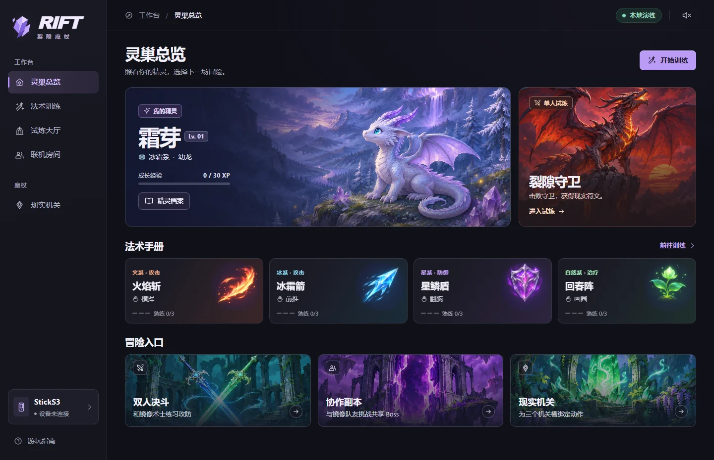

# StickS3

**《裂隙 RIFT》** 是为 M5Stack StickS3 设计的体感魔杖游戏。玩家用动作和声音为同一只小龙施法，挑战 Boss、与朋友决斗，并用通关获得的现实符文驱动已绑定的红外机关。

StickS3 横屏界面采用网页版的霜芽、四种法术和冒险场景原画。灵巢显示当前等级与经验，训练时短按 B 可切换法术并查看精通进度。运行 `.\stick.cmd run` 即可构建含原画的固件。更新 `web/assets` 中的原画后，可用装有 Pillow 的 Python 运行 `python tools/pack_display_art.py` 重新生成板载图集。

在本机运行 `.\stick.cmd watch`，浏览器打开终端中的地址进入「实机观战」。一台参战设备通过 USB 接入即可同步两位玩家的血量、盾层、蓄力、四技冷却与来袭提示。服务仅监听本机回环地址；离开观战页约两秒后释放串口。双机决斗需要两台都运行新版固件。

本项目采用规格驱动开发（SDD）。首版交付范围、硬件约束与验收入口如下。

| 文档 | 内容 |
|---|---|
| [首版规格](specs/001-rift/spec.md) | 玩家体验、首版边界、可观察行为 R1–R7 |
| [技术设计](specs/001-rift/design.md) | 实时决斗、协作回合、双机协议、外设仲裁与存档 |
| [板载状态 UI](specs/001-rift/board-ui.md) | 原画界面的操作提示、攻守双方的结算反馈，以及 240 × 135 简洁版预览 |
| [网页版灵巢工作台](web/index.html) | 下载后用浏览器打开，可本地演练法术、试炼、双人玩法和三个现实机关，进度保存在当前浏览器 |
| [验收计划](specs/001-rift/acceptance.md) | 每项需求的验证方法、预期结果和设备条件 |
| [构建与试玩](specs/001-rift/playtest.md) | 编译命令、双机组队、训练、红外机关及格挡灯光联动 |
| [验证记录](specs/001-rift/verification.md) | 已运行的测试、目标镜像和实机待验项目 |

