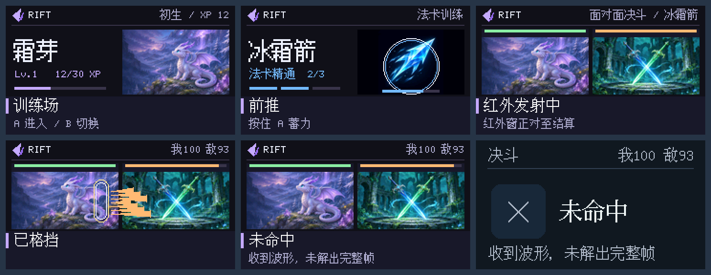

# StickS3 板载状态界面

板载屏显示真机当前动作和结算结果。[网页版灵巢](../../web/index.html)提供浏览器本地演练，精灵成长和机关设置分别保存在浏览器与魔杖。

## 屏幕与输入

显示区域为横屏 240 × 135 像素。默认界面使用与网页同源的霜芽、法术和场景原画。灵巢显示等级与经验，训练显示当前法术与精通，战斗显示双方血量。底部用两行说明当前动作和下一步。蓄力环随真实能量与节拍变化。

上图由固件绘图代码、内嵌图集和项目字体在桌面渲染。右下展示画布内存不足时的简洁界面，和默认界面使用同一组操作提示。

| 时机 | 板上提示 | 输入或显示依据 |
|---|---|---|
| 灵巢 | 当前入口或「休眠中」 | A 进入，B 切换。休眠时按键或轻摇 |
| 准备施法 | 「按住 A」和当前技能 | B 换技，A 按下后显示动作 |
| 动作进行中 | 「横挥」「前推」「翻腕」或「画圈」 | 识别成功后显示「松开 A」。进度条使用游戏给出的能量 |
| 对人判定 | 攻方先看到「准备瞄准」，开始发送后显示「红外发射中」。守方看到「翻腕格挡」 | 保持两台红外窗正对，直到回合结算 |
| 红外未命中 | 守方显示本轮接收提示，攻方提示查看守方屏幕 | 守方可区分接收器启动失败、未收到红外、波形不完整、收到其他码等情况。长提示占用底部整行 |
| 格挡结算 | 守方「已格挡」，攻方「对方格挡」 | 同一次格挡按本机角色显示各自结果 |
| 回合与结局 | 「队友回合」「已冰冻」「已治愈」「胜利」等。结算时顶栏显示双方血量，共斗另列队友血量 | 联机取房主同步结果，单机取本地规则结果 |
| 现实机关 | 槽号、「按遥控键」「挥杖松 A」「信号已发」 | 设备成功发送后才显示「信号已发」。灯的实际响应由玩家观察 |
| 异常 | 「连接超时」「动作未识别」「接收超时」等 | 临时提示优先显示，过期后恢复当前操作 |

## 代码与试用

游戏从 `src/main.cpp` 的 `render()` 生成板载状态。`src/display.cpp` 读取内嵌图集、绘制原画和状态提示，并将整帧送到屏幕。简洁界面由 `lib/RiftBoardUi` 直接绘制，相同状态跳过重绘，仅蓄力数值或节拍变化时只刷新能量条。

仓库正式构建使用 `.\stick.cmd run`。仅体验 UI 时可打开 `lib/RiftBoardUi/examples/BoardStatus/BoardStatus.ino`，或对该示例运行 Arduino CLI 并用 `--library lib/RiftBoardUi` 加载本地库。示例顶栏显示「界面预览」，按住 A 预览动作和蓄力，短按 B 换技，长按 B 进入状态浏览。浏览中短按 B 看下一项，按 A 返回。示例的蓄力来自按住时长。
